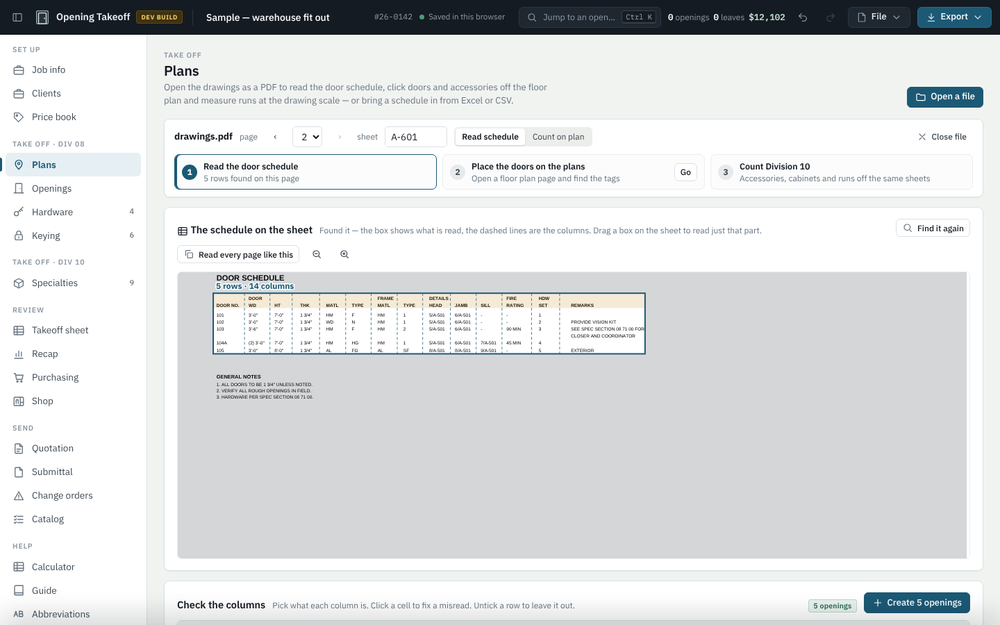
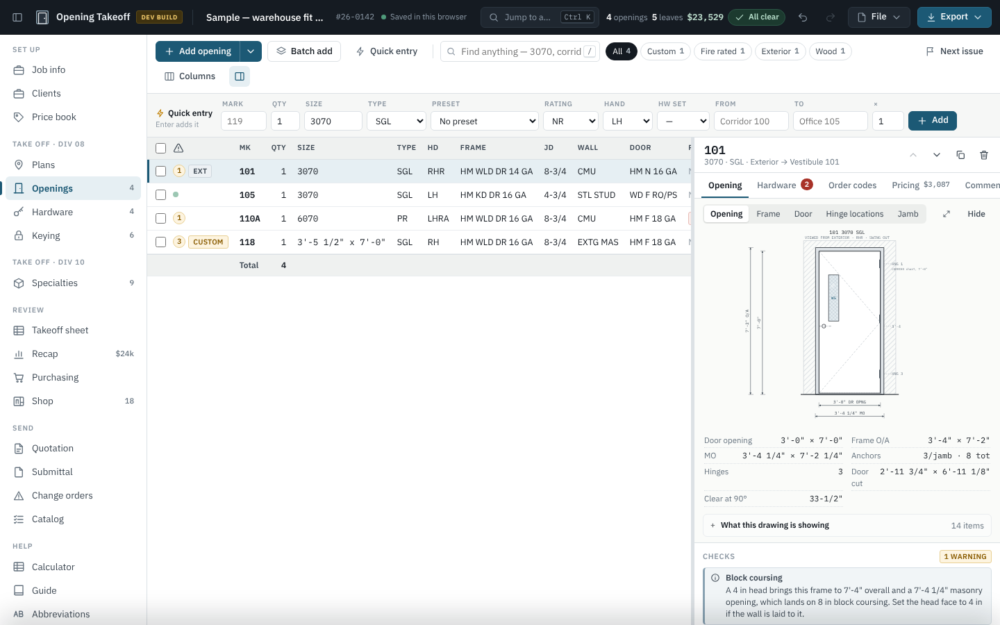
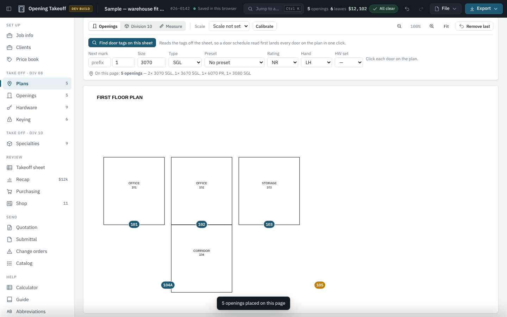
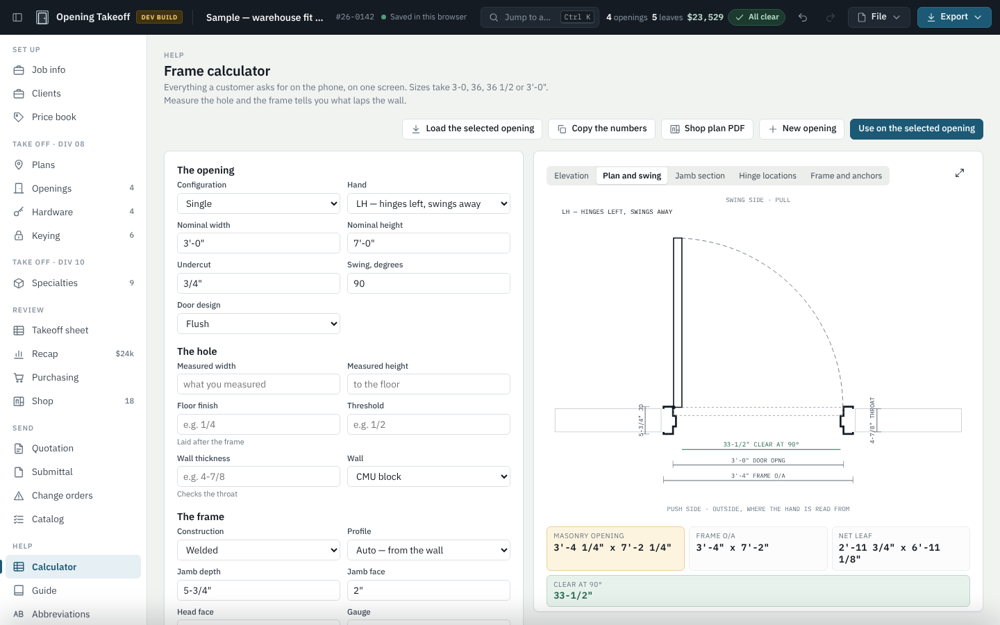
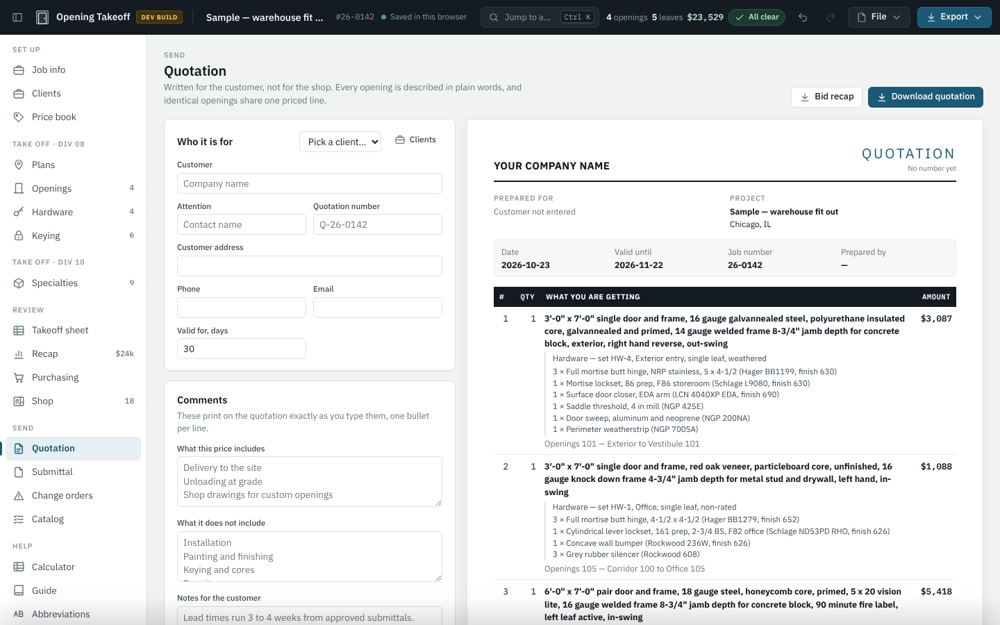
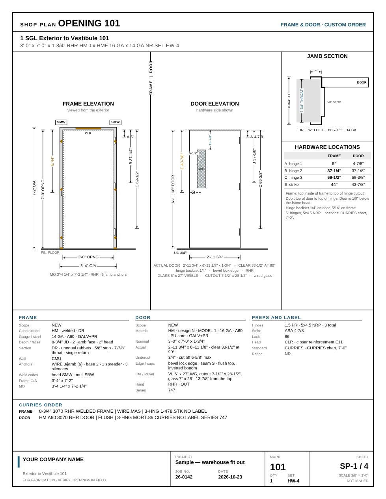
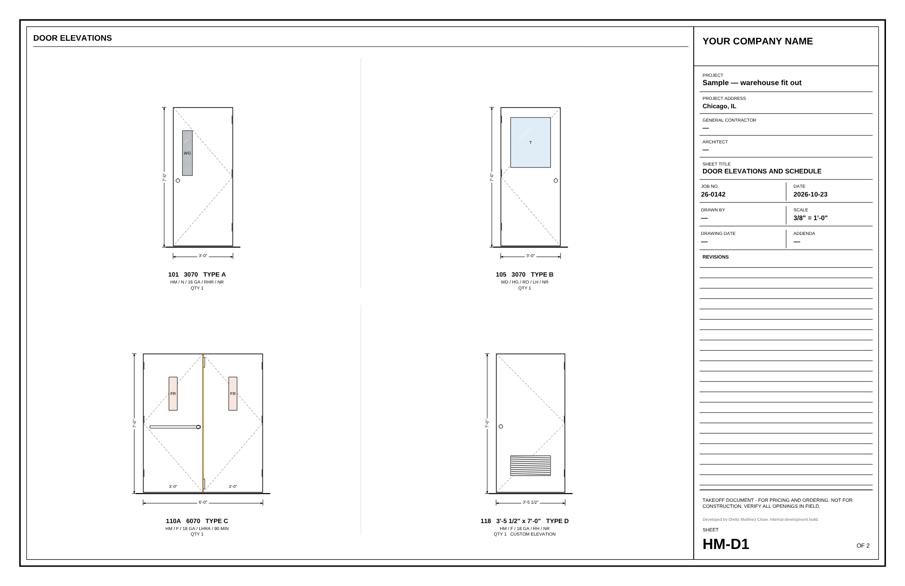

# Opening Takeoff

**Takeoff, drawings and quoting for doors, frames and hardware (Division 08) and specialties (Division 10). One HTML file, no install, works offline.**

Opening Takeoff takes a door job from the architect's drawings to a priced quotation and shop-ready paperwork:

1. It reads the door schedule off the PDF set.
2. It places every door on the floor plans by its tag.
3. It checks each opening against NFPA 80, ANSI/SDI and accessibility rules.
4. It draws the frames and doors to scale and prices the job.
5. It prints the quotation, submittal, keying schedule, purchase orders, shop plans and Curries order lines.

It is built by a working Div 08 estimator for the way distributors actually estimate. It runs in the browser from a single file, and your drawings and job data never leave your computer.



---

## Contents

- [Quick start](#quick-start)
- [What it does](#what-it-does)
- [How a job flows](#how-a-job-flows)
- [Screenshots](#screenshots)
- [Saving, sharing and backups](#saving-sharing-and-backups)
- [Requirements and limits](#requirements-and-limits)
- [Repository layout](#repository-layout)
- [FAQ](#faq)

---

## Quick start

1. **Download** `takeoff.html`: open it on GitHub and click **Download raw file**, or download the whole repository as a ZIP from **Code › Download ZIP**.
2. **Open it** in Chrome, Edge or Safari with a double-click. Nothing installs.
3. The first time, it loads a **sample job** and the **Guide** so you can click around.
4. To start for real: **File › Start a new empty job**. Then fill in **Job info**, including your company details, which print on every PDF.
5. **Try handing, units and spec sets:** open `samples/sample-units-and-spec.pdf`.
   - **Hardware sets:** it opens on the hardware specification. Click *Read the hardware sets*, then *Put these sets on the job*.
   - **Handing:** go to *Count on plan*, page 3, and click each door on its swing. Every door is added already handed (LH, RH, pair).
   - **Unit types:** page 1 is the enlarged plan of Unit A. Click its two doors, then go to *Units › New › This sheet is the enlarged plan*. On page 2, click *Find "UNIT A" on this sheet* (3 as drawn, 2 flipped), then *Put on the job*.
6. **Try the plan reader:** go to **Plans › Open a file** and pick `samples/sample-drawings.pdf`. It opens on the door schedule. Click **Create 5 openings**, then switch to **Count on plan**, go to page 1 and click **Find door tags on this sheet**.

> Reading PDFs uses pdf.js, which the app downloads once from cdnjs the first time you open a PDF. Everything else works with no internet connection.

---

## What it does

### Take off
| | |
|---|---|
| **Door schedule from the PDF** | Searches the whole set in seconds, using bookmarks first and then the back of the set, and opens the schedule on its first sheet as soon as it is found. Every sheet with a door schedule is listed, and *Read all* reads the schedule across all of them. A schedule printed in blocks side by side reads as one; window and finish schedules, legends and notes on the same sheet are left out; sideways sheets are turned upright. It handles two-row headers (DOOR / FRAME / DETAILS over WD, HT, THK), remarks that wrap onto a second line and pairs written as `(2) 3'-0"`. You can drag a box on the sheet to read only part of it, fix any cell with a click, untick rows, and read every page that carries the same schedule. Reading again after an addendum **updates** the openings instead of duplicating them. Excel (.xlsx) and CSV schedules work too. In a workbook, the door schedule tab is found on its own. |
| **Handing from the plan** | *Hand the doors from the swings* reads the door swings drawn on the sheet (arc and leaf) and sets each door's hand: LH / RH from the push side, LHR / RHR for out-swinging doors. It recognizes pairs and, with the scale set, flags a leaf that measures differently from the schedule. Click a door on its swing and it is handed as it is added. |
| **Unit types and flips** | For apartments, hotels and dorms: doors tagged once on the enlarged unit plan become the unit's doors. Count the units on each floor plan by their labels ("UNIT A", with FLIP / MIRROR / REV for flipped units) or by clicking. *Put on the job* multiplies the doors out and mirrors the hands on flipped units. |
| **Hardware sets from the spec** | Reads every set in Section 08 71 00: quantity, item, catalog number, finish and maker. It puts the listed doors on their set, flags electrified items (strikes, power transfers, power supplies, readers, mag locks, operators, DPS) and exports a low-voltage coordination list. |
| **Doors on the floor plans** | *Find door tags on this sheet* pins every scheduled door where its tag is drawn. When a room number reads the same as a tag, it picks the tag. It also lists tags on the sheet that are not in the job, and adds them in one click. |
| **Count and measure** | Click doors or Division 10 items on the plan. Set the drawing scale or calibrate on a known dimension, then measure corner guard, crash rail and other lineal-foot runs. |
| **Quick entry** | Type a line (`101 · 3070 · SGL · HW-1`) and press Enter. *Batch add* creates runs of openings. Presets cover common opening types. |

### Each opening
- **Live checks while you type:**
  - Fire label vs. closer, glazing, louvers and undercut
  - Pair coordinators and astragals
  - Throat vs. wall thickness and anchors vs. wall type
  - Hinge count on tall doors and block coursing
  - Duplicate marks and missing hardware sets
  - Doors that drag on the floor finish or threshold
  - NFPA 80 clearance under fire doors
  - 32" clear width, ½" threshold and 43" lite height on accessible doors
  - Lites that hit the lockset
- **Exact sizes:**
  - Nominal opening and frame overall size
  - Masonry or rough opening
  - Door as cut (unequal pairs too) and clear width at 90°
  - Clearance under the door once the floor finish or threshold is in
  - Maximum cut-off
  - Lite cutout and glass size
- **Drawings to scale:**
  - Opening, frame and door elevations
  - Jamb section with throat and stop
  - Hinge and strike locations from the manufacturer's chart (Curries, Steelcraft, Amweld, Ceco, Fenestra, Kewanee, Mesker, Pioneer, Republic) or ANSI/SDI A250.6
  - Every door design draws its own lite or louver: vision, narrow lite, half glass, full glass, stacked lites, louvers, embossed panels, dutch doors. Wired, tempered, laminated, insulated and fire-rated glass each look different.
- **Curries order lines** for the frame and the door, ready to copy.

### Hardware, keying and pricing
- **Hardware sets** with a product library and a DHI-style hardware schedule.
- **Keying:**
  - Master key system with keysets per door
  - Cylinders counted from the hardware sets
  - Auto-keying by level or by set
  - Keying schedule PDF with an owner-approval block
- **Price book:**
  - Multipliers by manufacturer
  - List prices on each hardware line
  - Import of manufacturer price lists from Excel or CSV
  - *Reprice this job* in one click
- **Pricing:**
  - Markups by category: frame, door, hardware, misc and Div 10
  - Install, shop-prep, field-measure and delivery labor
  - Freight and tax
  - One totals engine shared by the quote, recap, takeoff sheet and Excel

### Division 10
Toilet compartments and accessories, fire extinguishers and cabinets, lockers, signage, wall protection, markerboards, mailboxes, shelving and flagpoles, organized by CSI section with a starter list. Each line has quantity, unit (EA, LF, SF…), list price, cost, hours and its own markup.

### Output
- **Customer quotation** written in plain English, plus a **bid recap** for internal use.
- **Submittal package:** cover, hardware schedule, keying and elevations in one PDF.
- **11×17 frame and door elevation sheets** with an automatic scale and a title block.
- **Shop plan per opening:**
  - Frame and door elevations with the hinge chain and the lite located
  - Jamb section and hardware locations
  - Cut list, work orders and UL/WHI label log
- **Purchase orders** by vendor, with a manufacturer-to-distributor map.
- **Change orders** against a saved price baseline: added, changed and removed lines, with a signature block.
- **Excel workbook** and CSV exports of everything.

### Frame calculator
For the phone call or the site visit:
- Measure the hole and choose the frame to see how much face laps the wall at each jamb and at the head.
- Get the masonry or rough opening the frame needs and the net door size.
- See the clear width and the maximum cut-off, with the recommended undercut for the floor.
- Five live drawings: dimensioned elevation, plan with the door swing, jamb section, hinge locations, and frame with anchors.

---

## How a job flows

```
Set up         Job info · Clients · Price book
Take off       Plans (read the schedule, place the tags, count, measure)
               Openings · Hardware · Keying · Specialties (Div 10)
Review         Takeoff sheet · Recap · Purchasing · Shop
Send           Quotation · Submittal · Change orders · Catalog
```

Everything you export is under **Export** (top right). **Ctrl K** finds any opening or command, and **?** lists the keyboard shortcuts.

---

## Screenshots

| | |
|---|---|
|  |  |
| Openings: list, live elevation, sizes and checks | Plans: every scheduled door found on the sheet |
|  |  |
| Frame calculator: plan view with the swing and clear width | Quotation written for the customer |
|  |  |
| Shop plan: lite dimensioned, cutout and clear width | 11×17 door elevations: each door its own glass |

---

## Saving, sharing and backups

- **Autosave:** the job saves itself in the browser on every change. Undo and redo cover every edit.
- **Job files:** **File › Save job file** writes a `.json` you can keep in a shared folder, email or archive. **File › Open job file** brings it back. Job files from earlier versions open unchanged.
- **Per-browser data:** clients and the price book are kept in the browser across all jobs. Export them as CSV to move them to another computer.
- **Browser storage is not a backup.** Clearing site data in the browser deletes the autosaved job, so save a job file for anything that matters.

---

## Requirements and limits

- **Browsers:** current Chrome, Edge or Safari (desktop). Firefox works but is less tested. The app also has a phone layout for looking up openings and using the calculator in the field.
- **Internet:** only the first time a PDF is opened, to fetch pdf.js.
- **Scanned drawings:** a PDF with no text layer cannot be read automatically, because there is no OCR yet. Count those doors by clicking on the plan.
- **Single user:** there is no server and no shared database. Jobs are files.
- **Not an ERP:** no inventory or accounting.
- **Lite defaults:** standard lite sizes follow the Curries chart. The default locations (narrow-lite glass bottom at 43" AFF, vision lite centered at 60" AFF) and the 1½" cutout allowance are starting values. Check them against the project specification. The allowance is set in **Job info**.

---

## Repository layout

```
takeoff.html                  The whole application. This is the only file you need.
samples/sample-drawings.pdf   A floor plan and a door schedule to try the plan reader on.
samples/sample-units-and-spec.pdf  An enlarged unit plan, a floor plan with flipped units,
                              a plan with door swings and a hardware spec section.
docs/CHANGELOG.md             What changed in each version, and the bugs fixed.
docs/COMPETITIVE-ANALYSIS.md  Comsense, PRO-TECH and Software for Hardware compared.
docs/img/                     Screenshots used in this README.
```

---

## FAQ

**Does it send my drawings or prices anywhere?**
No. Everything runs in your browser. The only network request is the one-time download of pdf.js from cdnjs.

**Can I host it so others can open it from a link?**
Yes. It is a static file, so any static host works, including GitHub Pages, a shared drive or an intranet. Each person's jobs stay in their own browser unless they save and share job files.

**Will my old jobs open?**
Yes. Jobs saved in the browser and `.json` job files from 1.9 onward open with the same totals.

**Which manufacturers' hardware locations are built in?**
Curries, Steelcraft, Amweld, Ceco, Fenestra, Kewanee, Mesker, Pioneer and Republic charts, plus ANSI/SDI A250.6 standard locations. You can also type custom locations per opening.

---

*Developed by Orelio Martinez Chow.*
